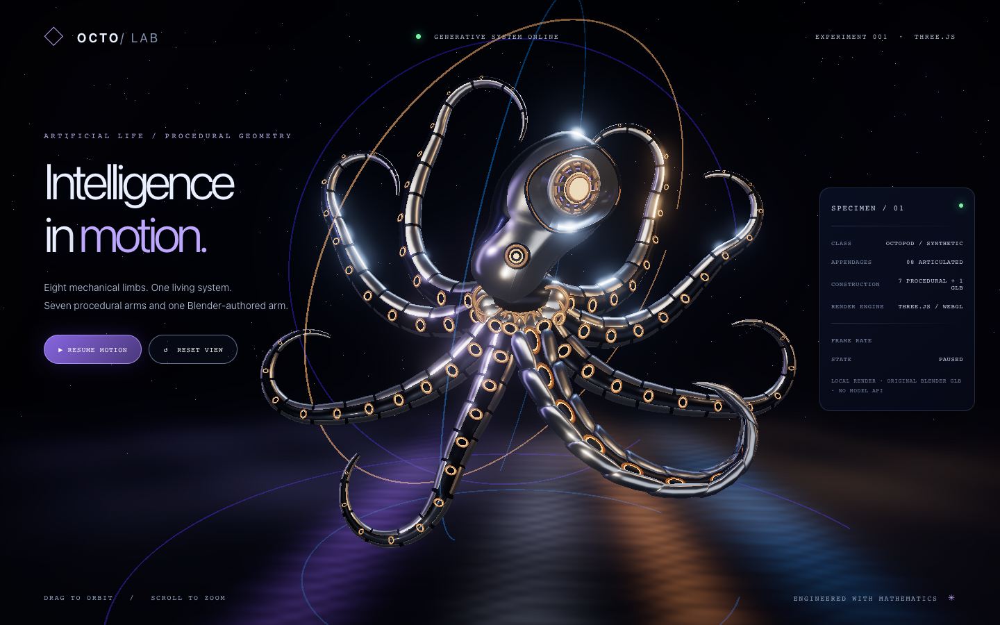

# OCTO closure evidence

Runtime and QA revision `a92477920108285dd8903e7f8c7083090dc89204`. Stage 6 base `27c2c5c9c7bc3876f20a42d26770dceb857c557f`. A is the default procedural scene. B opts into one Blender-authored arm.

- [Narrated 2:20 walkthrough](walkthrough.mp4) · [Transcript](walkthrough-transcript.md)
- [QA results, GLB hash, deformation data and timing summaries](validation.json)
- [A desktop](a-hero-desktop.png) · [B desktop](b-hero-desktop.png) · [A mobile](a-hero-mobile-390-3.4.png) · [B mobile](b-hero-mobile-390-3.4.png)
- [A detail](a-tentacle-detail.png) · [B detail](b-tentacle-detail.png)
- Raw rAF intervals in milliseconds · [A desktop](a-desktop-intervals.json) · [B desktop](b-desktop-intervals.json) · [A emulation](a-mobile-emulation-intervals.json) · [B emulation](b-mobile-emulation-intervals.json)

Study B is a static material demonstration. Its render and editable assets are stored separately. [Study B evidence](https://github.com/heyitschien/threejs-experiment-animations/tree/f5a724a58d3ef95bf19ce0b7cfb99031f05b5866)
