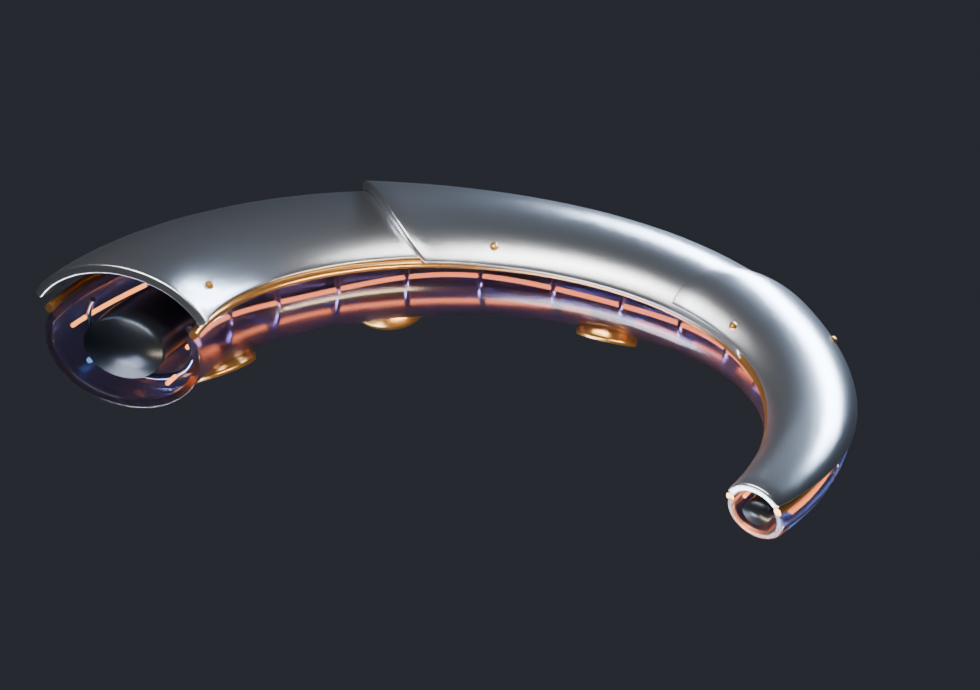
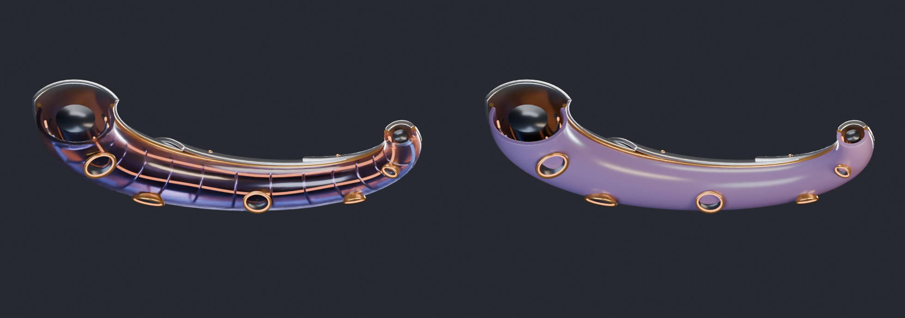

# OCTO · Translucent tentacle material study

One curved tentacle section built in Blender 5.2.4 LTS with three fitted metal plates, five recessed suckers, and a translucent wall over internal ribs and light channels.

The comparison uses the same geometry, camera and studio lighting. Only the shell material changes.

- **Blender renders** · [Armor](armor.png) · [Underside](underside.png) · [Opaque control](opaque.png) · [Clay geometry](clay.png)
- **Motion** · [Four-second Blender orbit](orbit.mp4)
- **Three.js captures** · [Armor](browser-armor.png) · [Underside](browser-underside.png) · [Opaque control](browser-opaque.png)
- **Source assets** · [Editable Blender scene](material-study.blend) · [GLB](section.glb) · [Python build script](build.py)

For review, check whether the shell reads as a wall with thickness, the ribs are legible through it, and the armor seams hold up as the camera moves. The browser uses simpler glass and reflections. The piece is static and has open demonstration ends.
