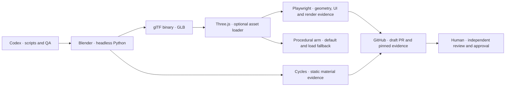

# Architecture

[Case study](AGENT-OPERATED-3D-CASE-STUDY.md) · [Playbook](IMPLEMENTATION-PLAYBOOK.md)

Study A binds one local GLB mesh assembly to the existing arm centerline. Three.js updates vertex positions and normals on the CPU. The other seven arms remain procedural. Both modes use the same interaction controls, and the default loads eight procedural arms. The development-only QA hook reads the live mesh at fixed poses.

Study B exports a separate static GLB and renders the editable Blender scene with Cycles. Three.js loads that separate model for material inspection. Neither Study B asset is a dependency of OCTO.

Git commits pin source and artifact provenance. Performance evidence describes the tested workstation and emulated viewport. Reviewers decide whether the visible result and the tested constraints justify integration.
