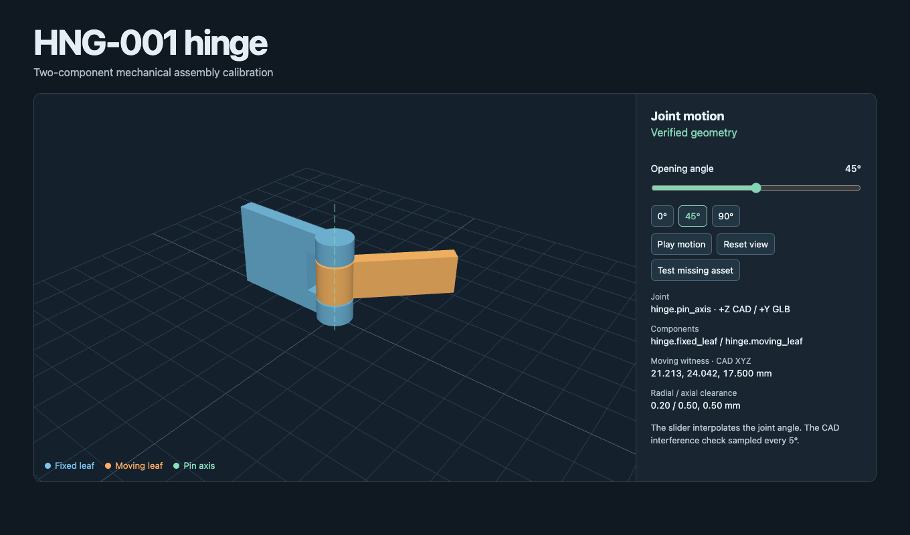
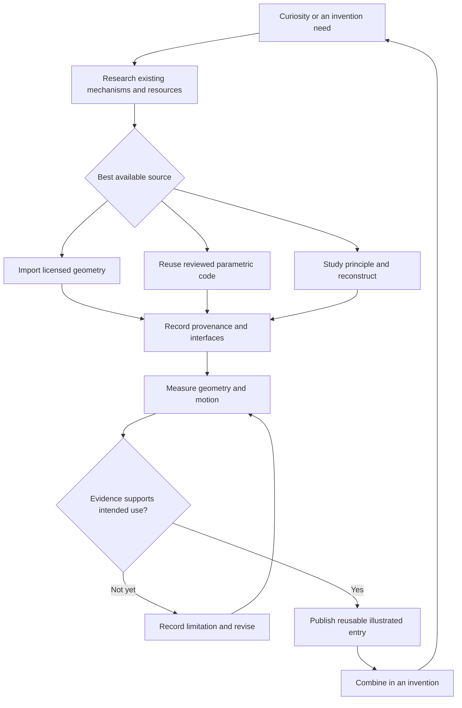

# Mechanical Intelligence — a living vocabulary

*Creative research direction · November 25, 2026 · v0.1*

> Learn from the mechanisms humanity has already discovered. Reuse what works, understand why it works, and combine ideas into new inventions.

A companion to [The Digital Garden of Inventions](INVENTION-LAB-DIGITAL-GARDEN.md). This is a proposed approach, not an approved implementation assignment. The [adoption and validation protocol](INVENTION-LAB-TECHNOLOGY-ADOPTION.md), [ADR-001](INVENTION-LAB-ADR-001-OPEN-SOURCE-INTEGRATION.md) and current issues govern executable work. Digital-only scope.

## 1. The vocabulary is knowledge, not just a model collection

A mechanical mechanism is a reusable principle for creating or transmitting motion, force or energy. A useful entry records the purpose, geometry, relationships, movement, mathematical assumptions, interfaces, provenance and evidence. Standard parts such as bearings and screws are supporting components; a catalog of parts alone is not a mechanism library.

Our hinge is the first *studied* entry: HNG-001 demonstrates bounded digital geometry, signed rotation and sampled fit on the tested Mac. Physical function and the edited-mesh verification follow-up remain open. No claim of manufacturing readiness.

*Actual Session 0.3A screenshot, not a new render or physical test. See the [engineering receipts](../experiments/invention-lab/hng-001/evidence/README.md) and [runbook](INVENTION-LAB-HNG-001-RUNBOOK.md).*

## 2. Choose the smallest useful acquisition path

| Path | Use when | What must be checked |
| --- | --- | --- |
| Import existing geometry | Standard or reference part with appropriate dimensions and documented rights | Exact source, model license, revision, units, solid validity, scale, topology, interfaces and required metadata. Prefer STEP for precise interchange; mesh alone is visual reference unless independently justified. |
| Reuse existing code | A parameterized generator or solver already meets our need | Pinned source, licenses and dependencies; review code and security, isolate execution, test parameters and independent mathematical expectations. Keep attribution. |
| Study and reconstruct | A useful historical mechanism or research principle lacks suitable geometry/code, or recreating it is the learning goal | Cite the source, derive our own dimensions and constraints, test the resulting motion, document assumptions and differences. Do not copy restricted assets. |
| Invent a new variant | Existing options fail a real requirement or curiosity suggests a worthwhile alternative | Define a measurable question, compare against an existing mechanism, distinguish novelty from performance and record tradeoffs. |

Use multiple paths in one assembly: for example, import a licensed bearing, reuse a suitable fastener generator, and reconstruct the linkage that joins them. Avoid mass downloading, blindly importing untrusted geometry, or rebuilding mature tools to fill a catalog. A source reference can be useful even if we never adopt its software.

## 3. A discovery shelf — references to investigate

Initial source reconnaissance; no candidate has been installed or validated in this session. Repository license observations are from the project LICENSE files, not a full dependency/asset redistribution review. Pin exact revisions and review licenses before adoption.

| Resource | What to learn or reuse | Initial boundary |
| --- | --- | --- |
| [Henry T. Brown, 507 Mechanical Movements](https://507movements.com/) · [site rights](https://507movements.com/about.html) | Classic mechanical principles and visual explanations | Historical reference. Original historic text/figures may be public domain in the US; modern site layout and animations have separate copyright. Link or create original diagrams; verify specific asset rights. |
| [Cornell KMODDL](https://engineering.library.cornell.edu/database/kmoddl-kinematic-models-for-digital-design-library/) · [four-bar model](https://dcp-production-container.library.cornell.edu/catalog/ss%3A29272037) | Reuleaux teaching models, mechanism classification and visual study | Open-access reference, not blanket permission to redistribute individual images, videos or files. Check item rights. |
| [MotionGen / Stony Brook](https://www.stonybrook.edu/commcms/motiongen/what.html) · [documentation](https://docs.motiongen.io/) | Planar mechanism design, synthesis and kinematics; comparison reference | Documented research software; do not assume its engine is open-source or redistributable. Review access, licensing and export options before use. |
| [cq_warehouse](https://github.com/gumyr/cq_warehouse) · [license](https://github.com/gumyr/cq_warehouse/blob/main/LICENSE) | On-demand parametric parts and CadQuery extensions | Apache-2.0 project license observed; promising existing CadQuery lane. Check dependency compatibility, standards data, notices and test selected generator. |
| [CQ_Gears](https://github.com/meadiode/cq_gears) · [license](https://github.com/meadiode/cq_gears/blob/main/LICENSE) | Parametric gear generation, including spur and planetary sets | Apache-2.0 project license observed. README describes work in progress and a developer-version CadQuery requirement; verify against our pinned 2.8.0 before any adoption. |
| [bd_warehouse](https://github.com/gumyr/bd_warehouse) · [license](https://github.com/gumyr/bd_warehouse/blob/main/LICENSE) | Parametric part collection for build123d | Apache-2.0 project license observed. Evaluate only in an approved separate build123d environment if required; do not mix CAD kernels in the canonical lane. |

Other discovery areas: compliant mechanisms, cam/follower synthesis, open component catalogs, and existing assembly/kinematics solvers. Research actual models, source code, maintenance, formats, rights and engineering validity before selecting a candidate. The existing ADR covers Text-to-CAD, AgentCAD, Assembly Harness and CADGenBench.

## 4. What a reusable vocabulary entry should contain

Start with ordinary Markdown, structured parameters and existing runbooks. No new catalog platform, database, indexing service or agent framework is necessary.

| Record | Purpose |
| --- | --- |
| Identity | Stable ID, mechanism family, synonyms, version, source and author/attribution |
| Intent | What problem it solves; input/output motion; degrees of freedom; limitations |
| Geometry | Authoritative editable source or licensed STEP with documented parameters; derived meshes clearly labeled |
| Interfaces | Named parts, joint axes, frames, dimensions, range, connection points and units |
| Mathematics | Independent expected relationships, constraints and assumptions; example inputs/outputs |
| Evidence | Valid geometry, measured fit/pose, negative controls, reproduction receipts, known failures; dynamic/physical claims require additional validation |
| Reuse | Minimal instructions for any agent to generate/import, configure, test and combine the mechanism |
| Visual explanation | Hero view, labeled mechanism diagram, dimensioned CAD drawing, important motion states and optionally the actual interactive viewer |
| Provenance | Pinned code/source revision, model/asset license, modifications, notices, artifact hashes and tool versions |

Suggested status labels: **discovered**, **studied**, **digitally validated within stated scope**, **approved for reuse within stated scope**. A mechanism may remain a reference forever. Do not promote a visually convincing animation into a validated mechanical system.

Proposed minimal entry directory if/when needed: `README.md`, `spec.json`, source or source reference, `assets/` for original permitted visual explanation, and links to immutable evidence. Keep large binaries outside Git until approved. Existing HNG-001 layout stays unchanged; link rather than duplicate. A machine-readable catalog can emerge when multiple entries demonstrate a real retrieval need.

## 5. An illustrated path from hinge to Living Window

| Mechanism family | Question we could explore | Potential application |
| --- | --- | --- |
| Revolute joint / hinge | How can one part rotate without geometric interference? | A moving window shade |
| Four-bar linkage | How can one motion guide another along a chosen path? | A coupled opening or adjustment mechanism |
| Parallel linkage / connecting rod | Can one input coordinate multiple slats? | Synchronized shading |
| Cam or gear train | How can motion be transformed or timed? | Alternate shade control |
| Compliant mechanism | Can a flexible part replace several moving joints? | Low-part-count experimental mechanism |

The four-bar/parallel linkage is a suggested next creative study after current engineering gates, because it naturally extends the hinge lesson and relates to the Living Window. Start by studying historical examples and existing synthesis/parametric implementations. If an appropriate licensed solution exists, reuse it; otherwise derive a simple lab-owned reference from published principles. Before running a fixture, freeze independent link-length/loop-closure and signed joint expectations, joint limits, known infeasible configurations, clearance tests and evidence thresholds. Validate the chosen mechanism in its own right before composing it into the window. Animation does not prove dynamics, forces or continuous collision freedom.

Other branches of the garden can grow whenever curiosity leads there: gears, iris apertures, deployable structures, compliant mechanisms and nature-inspired grasping. No fixed count or compulsory roadmap.

## 6. Visual documentation as a lab practice

The human collaborator values illustrated explanations because they make mechanisms easier to understand. Preserve that quality in future durable documentation where practical:

- Lead with a meaningful visual and a plain-English explanation of the mechanism.
- Prefer original CAD-derived diagrams, annotated screenshots, SVG or Mermaid diagrams and comparison images that clarify movement, geometry and evidence. Reuse existing verified screenshots before generating decorative imagery.
- Separate artistic concept images, schematic explanations and dimensionally authoritative drawings. Label assumptions and evidence status in captions. Do not use generated imagery as measurement evidence.
- Use relative repository paths, accessible alt text, concise captions, original or permitted imagery, attribution and asset provenance. Review sizes and rights before committing files; external references may be linked instead.
- Keep the technical source, parameters, runbook and test receipts alongside the visual narrative. A future interactive exhibition may present these records, but no new website is required to start.

## 7. The principle

Study first, reuse intelligently, reconstruct when it teaches us something, and invent when curiosity or a real problem calls for it.

Every mechanism can become a word in our engineering vocabulary. Every invention is a new way to combine those words. The purpose is not to accumulate hundreds of files; it is to accumulate understanding.

**The inventions become our curriculum. The pipeline becomes our laboratory. Curiosity becomes our teacher.**
