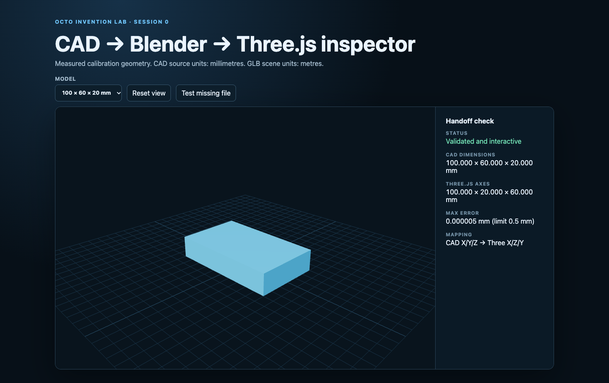
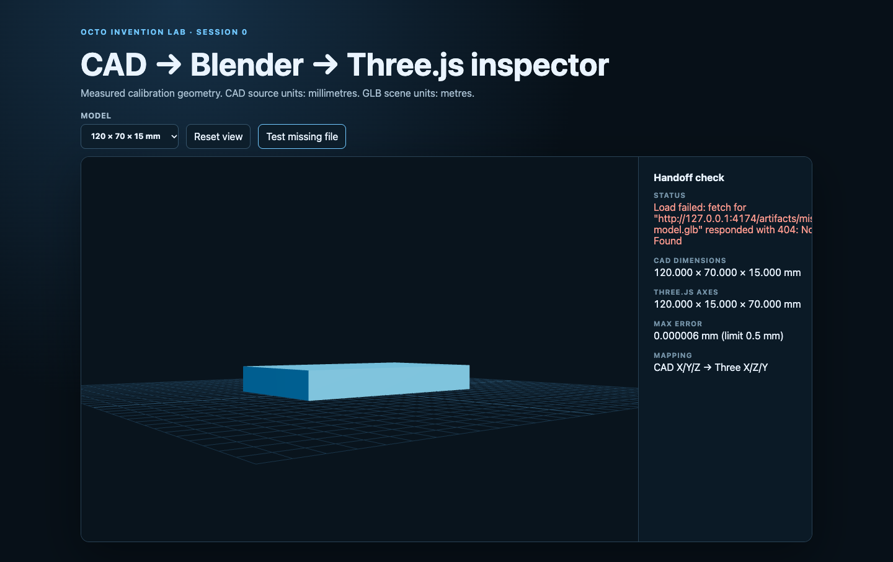

# Invention Lab Session 0 — CAD → Blender → Three.js setup evidence

**Result:** PASS on 2026-11-24 (America/Los_Angeles). A real measured CadQuery solid was exported to STEP and tessellated STL, imported by Blender at explicit millimetre-to-metre scale, exported as Y-up GLB, measured with Three.js, and rendered in an isolated interactive browser viewer. A second parameter variation passed the same checks. This is a calibration pipeline only; it does not begin Living Window Phase E/F, simulation, fabrication, deployment, or OCTO runtime changes.

## Selected pipeline

| Boundary | Selected implementation | Authority / unit contract |
| --- | --- | --- |
| Parametric CAD | Python 3.12.12 + CadQuery 2.8.0 + OCP 7.9.3.1 | `model.py` and STEP are authoritative; millimetres, right-handed, Z-up |
| Tessellation | CadQuery STL export | 0.05 mm linear / 0.1 rad angular tolerance; numeric STL coordinates explicitly treated as mm |
| Staging | Blender 4.4.0 CLI | STL import `global_scale=0.001`; Blender metres, Z-up; no geometry edits |
| Browser derivative | Blender GLB + Three.js 0.187.0 | glTF export `export_yup=true`; Three.js metres, Y-up; CAD X/Y/Z maps to Three X/Z/Y |
| Interaction QA | Vite 7.3.8 + Playwright 1.65.1 / Chromium 159.0.8154.6 | Orbit, variant select, units, missing-file state and recovery |

The integration threshold was declared before the result: **≤0.5 mm absolute bounds error**. This is an interop threshold, not a manufacturing tolerance.

## Observed environment

- macOS 26.6.2 (25G83), arm64, Apple M3 Max; 74 GiB free at start.
- Global Python 3.14.5 was not used because the tested CAD stacks support Python through 3.12. Homebrew Python 3.12.12 was used only to create isolated venvs.
- Blender existed at the standard macOS application path but was not on `PATH`. Headless startup and Python automation passed. Blender reported 4.4.0, build `05377985c527`, embedded Python 3.11.11.
- FreeCAD was not installed. It was not added because CadQuery STEP re-import and agentcad's independent written-STEP validation covered the bounded Session 0 file round trip. FreeCAD remains an optional later verifier.
- Node 26.13.0 and npm 11.20.0 were observed. `npm ci` resolved the committed lock to Three.js 0.187.0, Vite 7.3.8 and Playwright 1.65.1.
- Full machine-readable versions and the clean base SHA are in [`versions.json`](versions.json).

Security/provenance note: the installed Blender app has a valid Blender Foundation Developer ID signature and its CLI worked, but `spctl` reported “a sealed resource is missing or invalid.” Therefore this report does not claim the local application bundle is pristine. All validation ran with `--factory-startup`.

## Fresh setup and reproduction

Run from the repository root. The commands create only project-local dependencies and use the existing package lock.

```bash
uv venv --python /opt/homebrew/bin/python3.12 .venv-cadquery
uv pip sync --python .venv-cadquery/bin/python \
  experiments/invention-lab/session-0/requirements-cadquery.lock

npm ci
npm run check
npm run qa:install

experiments/invention-lab/session-0/run_pipeline.sh
```

`run_pipeline.sh` accepts `CADQUERY_PYTHON` and `BLENDER_BIN` overrides for machines where those executables live elsewhere. It produces the CAD, STEP re-import, STL, Blender and GLB reports under `artifacts/`.

Start the isolated viewer and run browser QA in separate terminals:

```bash
./node_modules/.bin/vite experiments/invention-lab/session-0 \
  --host 127.0.0.1 --port 4174 --strictPort

PLAYWRIGHT_BROWSERS_PATH=0 node \
  experiments/invention-lab/session-0/browser_qa.mjs \
  http://127.0.0.1:4174 \
  experiments/invention-lab/session-0/screenshots
```

On a fresh macOS venv, the first import of the large signed native OCP/VTK/CasADi dependency set can spend roughly 1–2 minutes in operating-system verification with no console output. Subsequent CadQuery imports measured about 1.9 seconds. Interrupting that first import does not mean package resolution failed; rerun once after verifying the installed wheels and process activity.

## Validation results

| Check | 100 × 60 × 20 mm | 120 × 70 × 15 mm |
| --- | ---: | ---: |
| CAD B-rep valid / solids | yes / 1 | yes / 1 |
| CAD volume | 120,000 mm³ | 126,000 mm³ |
| STEP re-import valid | yes | yes |
| STEP volume error | 0 mm³ | 0 mm³ |
| Tessellated mesh | 24 vertices / 12 triangles | 24 vertices / 12 triangles |
| Blender bounds max error | 0.0000024 mm | 0.0000048 mm |
| Three.js GLB bounds max error | 0.0000048 mm | 0.0000057 mm |
| Integration threshold | pass (≤0.5 mm) | pass (≤0.5 mm) |

Machine-readable receipts:

- [`cad-metrics.json`](artifacts/cad-metrics.json): source B-rep, STEP re-import, mesh metrics and hashes.
- [`blender-metrics.json`](artifacts/blender-metrics.json): scaled Blender bounds and GLB hashes.
- [`glb-metrics.json`](artifacts/glb-metrics.json): Three.js parsed bounds and axis mapping.
- [`determinism.json`](artifacts/determinism.json): same-environment second run.
- [`fresh-environment-reproduction.json`](artifacts/fresh-environment-reproduction.json): a second fresh venv restored from the lock.
- [`browser-qa.json`](screenshots/browser-qa.json): orbit, model switching, expected missing-file 404, recovery and console/page-error receipts.

Repeat generation produced identical geometry metrics and byte-identical STL files. STEP files were not byte-identical because OpenCascade writes the generation time in the `FILE_NAME` header; STEP re-import dimensions, topology and volume were identical. Raw STEP hash equality is therefore not used as a geometry criterion.

## agentcad evaluation

[agentcad 0.8.1](https://github.com/jdilla1277/agentcad/releases/tag/v0.8.1) was evaluated before any custom integration. It is Apache-2.0, self-described alpha software, and supports Python 3.10–3.12. Its CadQuery extra currently constrains OCP below 7.9, so the isolated smoke environment resolved CadQuery 2.7.0 / OCP 7.8.1.1.post1 rather than the selected CadQuery 2.8.0 / OCP 7.9.3.1 direct environment.

The disposable 100 × 60 × 20 mm smoke test passed in 2.562 s: valid STEP round trip, one closed solid, 120,000 mm³ volume, no free edges, and manifold/watertight 12-triangle STL and GLB outputs. See [`agentcad-evaluation.json`](artifacts/agentcad-evaluation.json).

Decision: keep direct CadQuery for Session 0. It is the current release, uses 44 packages versus agentcad's 73 in this test, avoids a second CAD-version authority, and needs no orchestration layer for two deterministic solids. agentcad remains a credible later validation/orchestration candidate; no custom MCP server was created.

Disposable evaluation commands (paths intentionally generic):

```bash
uv venv --python /opt/homebrew/bin/python3.12 .venv-agentcad
uv pip install --python .venv-agentcad/bin/python 'agentcad[cadquery]==0.8.1'

agentcad init --name session0-smoke --runtime cadquery \
  --no-agent-setup --build-dir "$AGENTCAD_BUILD"
agentcad run experiments/invention-lab/session-0/agentcad_smoke.py \
  --label box --no-preview --no-diff --no-view --export stl,glb \
  --build-dir "$AGENTCAD_BUILD"
```

## Browser evidence





Playwright confirmed that pointer drag changed the camera, both model variants loaded, displayed units and measured dimensions matched the GLB report, the intentionally missing asset produced one expected 404 with a visible error, and the viewer recovered to the valid model. There were no page exceptions or unexpected console errors.

## Baseline and scope receipts

- Clean starting SHA: `bbae192fbc9bb0cbf05156eb5c52f2e0b9271f34` on `docs/invention-lab-proposal`.
- Isolated worktree branch: `codex/invention-lab-session0`.
- Baseline `npm run check`: **17/17 Node tests passed** and Vite production build passed. Existing chunk-size warning only; no OCTO source, goldens or release artifacts changed.
- Browser installation used the repository's locked `npm run qa:install` and downloaded Chromium plus FFmpeg locally under `node_modules`.
- No sudo, global Python changes, account creation, paid service, deployment, merge, physical fabrication, CFD/FEM, Phase E or Phase F work.

## Warnings and next decision

No major installation or compatibility blocker remains. Reviewers should decide whether to keep this small calibration harness as the Session 1 foundation and whether FreeCAD adds enough independent value to justify its separate installation. Before Phase E/F, review the Blender app seal warning, approve the actual model brief/parameters, and keep CAD/STEP authoritative over GLB and browser presentation.
